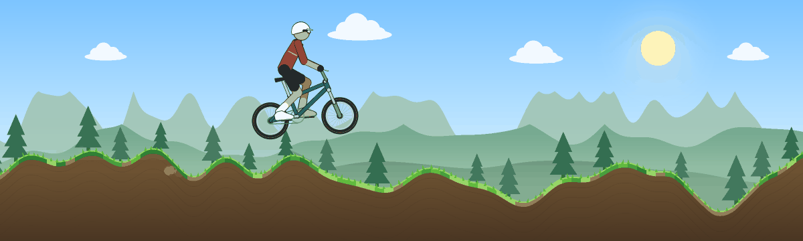
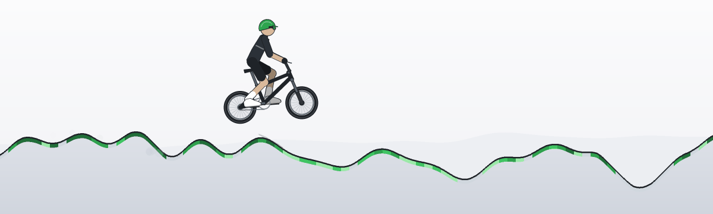
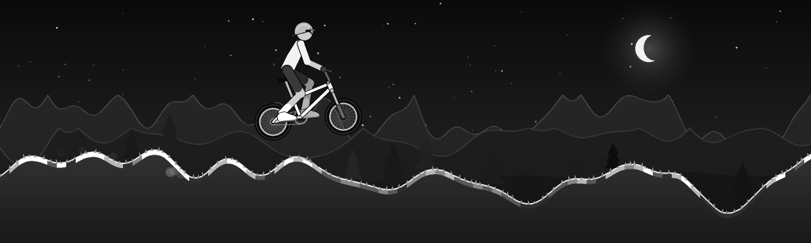

# 🚴 Commit Rider

**Your GitHub contributions. Your terrain. Your ride.**

Commit Rider turns your GitHub contribution history into an animated, side-scrolling bicycle ride and
keeps it up to date in your profile README. Every day's contributions shape the trail: busy days build
hills and ramps, quiet stretches roll out into valleys. A small cyclist rides the real terrain: wheels
turn with the distance covered, legs pedal, the body leans into climbs, and the bike jumps, lands and
sometimes pops a wheelie.


<sub>The demo above is generated from <em>synthetic</em> sample data
(<code>examples/sample-contributions.json</code>), not from anyone's real activity. 1200×360, 144 frames,
8 s, loops seamlessly, about 5.9 MB.</sub>

## Quick start

**1. Try it locally, no account or token needed** (needs Python 3.11+):

```bash
python -m pip install "git+https://github.com/Sumit6258/commit-rider.git"
commit-rider --source demo --output dist/demo.gif
```

**2. Use your real contributions** (needs a token, see [Authentication](#authentication)):

```bash
export GITHUB_TOKEN=...            # never put the token on the command line
commit-rider --username YOUR_NAME --output dist/commit-rider.gif
```

**3. Put it on your profile**, updated every day by GitHub Actions: add
[`examples/workflows/commit-rider.yml`](examples/workflows/commit-rider.yml) to your profile repository as
`.github/workflows/commit-rider.yml`, run it once from the *Actions* tab, then add this to your profile
`README.md` (replace `USERNAME` with your GitHub username):

```markdown
## 🚴 My GitHub Commit Rider


```

The complete walk-through for people who have never used a GitHub Action is in
[docs/installation.md](docs/installation.md).

## Installation

| You want to… | Do this |
|---|---|
| Keep an animation on your profile | Use the **GitHub Action** (recommended): [docs/installation.md](docs/installation.md) |
| Generate GIFs on your own machine | `pip install "git+https://github.com/Sumit6258/commit-rider.git"` (or `@v1.0.0` for a fixed version) |
| Work on Commit Rider itself | `git clone`, then `python -m pip install -e ".[dev]"` (see [CONTRIBUTING.md](CONTRIBUTING.md)) |

The only runtime dependency is [Pillow](https://python-pillow.org/); the HTTP client uses the Python standard
library.

The GitHub Action in a workflow:

```yaml
- uses: actions/checkout@v6
- uses: Sumit6258/commit-rider@v1
  with:
    username: ${{ github.repository_owner }}
    theme: midnight
    publish-branch: output   # commits commit-rider.gif to a branch named "output"
```

## Features

- **A real terrain, not a backdrop.** Daily counts are mapped to height with a robust scale (p90
  reference, soft-capped peaks), smoothed with a monotone cubic curve, and limited to a rideable slope.
  One 5000-commit day does not flatten the rest of the year; a quiet account still gets visible hills.
- **A real small physics engine.** Wheels rest on the terrain (no penetration, ever), the bike pitches
  with the slope, wheel spin equals distance rolled, jumps are true parabolas launched from the lips of
  ramps, landings compress the rider and the fork, and the pedals level out in the air.
- **A character with joints.** Original vector rider and BMX-style bike; legs, arms and torso are driven
  by inverse kinematics so hands stay on the bars and feet on the pedals in every pose.
- **A seamless loop.** The track closes on itself through a gentle valley; the frame after the last is
  pixel-identical to the first. Wheels, cranks, camera, parallax and dust all loop.
- **Seven themes**, custom colours, five terrain modes, four ride modes, optional stunts (wheelies,
  backflips), optional statistics overlay.
- **Small, valid GIFs.** One global palette (no colour flicker), inter-frame transparency, automatic
  quality reduction to meet a size limit, and validation of the written file.
- **Safe by design.** Aggregate data only, tokens never logged, no third-party actions, bounded
  retries and resource limits ([SECURITY.md](SECURITY.md)).
- **Deterministic.** The same data and settings produce the same bytes.

### How to read the animation

| On screen | Means |
|---|---|
| A hill | A busy stretch of days; taller means more contributions |
| A valley or flat stretch | A quiet stretch (days with no contributions) |
| A ramp and a jump | A steep climb that ends abruptly: a burst of activity after a quiet spell |
| Colour of the trail | The day's activity level (GitHub-style, five levels; quartiles of your active days) |
| The first and last stretch of the loop | A calm "bridge" valley joining the end of the year back to its start |

> **What is counted.** GitHub's contribution calendar counts *eligible contributions* (commits to a
> default or gh-pages branch, opened issues, pull requests, reviews, discussions and so on), not only
> commits, and it uses UTC calendar days. "Commit Rider" is a name, not a promise that each unit is a
> commit.

## Themes

| | |
|---|---|
| **midnight** (default)  | **forest**  |
| **sunset**  | **neon**  |
| **snow**  | **minimal**  |
| **monochrome**  | Your own: `--theme-file`, or override colours with `bike-color`, `rider-color`, `terrain-color`, `background-color` |

Themes are plain data (`src/commit_rider/rendering/themes.py`); adding one never touches the animation code.

## Configuration

Everything has a good default. The most useful options (full reference: [docs/configuration.md](docs/configuration.md)):

| Option | Default | Meaning |
|---|---|---|
| `theme` | `midnight` | midnight, forest, sunset, neon, snow, minimal, monochrome |
| `width` × `height` | 1200 × 360 | Pixels (320-2400 × 96-900) |
| `fps` / `duration` | 18 / 8 | Frames per second (5-30); seconds for one lap (2-30) |
| `days` | 365 | How many recent days to ride (7-1100) |
| `ride-mode` | `normal` | `normal`, `speed`, `stunt`, `relaxed` |
| `terrain-mode` | `natural` | `natural`, `rolling`, `ramps`, `mountain`, `arcade` |
| `show-stats` | `false` | Overlay total, range, best day, average, streak |
| `quality` | `standard` | `draft`, `standard`, `high` (supersampling) |
| `max-size-mb` | `8` | Soft limit in MiB; quality is reduced step by step to fit |

## Authentication

GitHub's GraphQL API needs an authenticated request even for public data.

| Mode | Token | What you get |
|---|---|---|
| **Public contributions** (default in the Action) | The built-in `GITHUB_TOKEN`; nothing to set up | Your public contribution calendar |
| **Plus private contribution count** | A *classic* personal access token with the `read:user` scope, stored as a repository secret | The same calendar, plus GitHub's aggregate count of contributions that are not visible per day, shown as a number only |
| **Offline demo** | None | Synthetic data |

GitHub documents that contributions in private and internal repositories are only included with the
`read:user` scope. Commit Rider never requests repository names, commit messages or any repository
detail; private data stays an aggregate number and is never spread over days. The exact permissions,
how to create and store the token and what was and was not verified are in
[docs/installation.md](docs/installation.md#tokens-and-permissions).

## Troubleshooting

The most common problems (token errors, rate limits, "the image does not update", the file being too large,
scheduled runs not starting) have step-by-step answers in [docs/troubleshooting.md](docs/troubleshooting.md).
Run locally with `-vv` for detailed logs; tokens are redacted from all output.

## Known limitations

- The Action's runner script assumes a Linux or macOS runner with `bash` (use `ubuntu-latest`).
- The bundled bike is a single, carefully drawn BMX-style bicycle; more styles are a welcome contribution.
- A GIF of a full year is a few megabytes. That is fine for a README, but raise `max-size-mb` carefully or
  reduce `width`, `fps` or `duration` if you need it smaller.
- Very short ranges (a few weeks) work, but the scenery then repeats more obviously.

## Contributing

Contributions are welcome: themes, bikes, terrain modes, docs, bug reports. Start with
[CONTRIBUTING.md](CONTRIBUTING.md) and [docs/architecture.md](docs/architecture.md).

## License

[MIT](LICENSE). All artwork is original and generated by the code ([assets/README.md](assets/README.md)).
