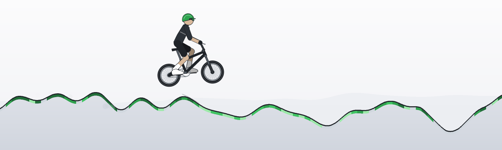

# Examples

All images here are generated from *synthetic* sample data (`examples/sample-contributions.json`). Regenerate
them with `python tools/make_examples.py`.

## The default ride

```bash
commit-rider --input-json examples/sample-contributions.json --output examples/demo.gif
```


## Themes

| | |
|---|---|
| midnight  | forest  |
| sunset  | neon  |
| snow  | minimal  |
| monochrome  | |

## Command recipes

```bash
# Offline, no token: try everything with synthetic data
commit-rider --source demo --theme sunset --ride-mode stunt --output dist/stunts.gif

# A smaller file for a narrow README column
commit-rider --username YOUR_NAME --width 800 --height 240 --fps 15 --duration 6 --output dist/small.gif

# Only the last 90 days, with statistics
commit-rider --username YOUR_NAME --days 90 --show-stats --output dist/recent.gif

# A specific period
commit-rider --username YOUR_NAME --from 2026-01-01 --to 2026-06-30 --output dist/h1.gif

# Your own colours
commit-rider --source demo --bike-color "#ff3366" --rider-color "#ffd60a" --terrain-color "#2a9d8f" --output dist/mine.gif

# A saved API response or any JSON of daily counts
commit-rider --input-json my-days.json --output dist/custom.gif

# Settings from a file (flags override it)
commit-rider --source demo --config my-settings.json --output dist/cfg.gif
```

`my-settings.json`:

```json
{ "theme": "forest", "ride-mode": "speed", "terrain-mode": "ramps", "show-stats": true }
```

## Using the Action's outputs

```yaml
- id: ride
  uses: Sumit6258/commit-rider@v1
  with:
    username: ${{ github.repository_owner }}
- run: echo "Rode ${{ steps.ride.outputs.total-contributions }} contributions in ${{ steps.ride.outputs.frames }} frames"
- uses: actions/upload-artifact@v4
  with:
    name: commit-rider
    path: ${{ steps.ride.outputs.path }}
```
